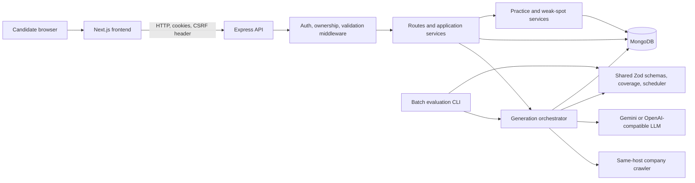
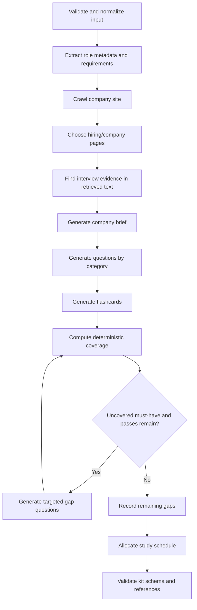

# AI Interview Prep Kit

**Assessment ID:** `FS-AI-INTERVIEW-01`

AI Interview Prep Kit turns a candidate's pasted job description, company URL, and preparation window into an editable interview study kit. The kit combines extracted requirements, interview questions, flashcards, a day-by-day schedule, and requirement coverage data. Candidates can practice, rate recall confidence, and review weak spots.

The repository is an npm workspaces monorepo with separate `frontend/`, `backend/`, and `shared/` folders. This README describes the current source and records verification limits as well as implemented behavior. It does not claim a public deployment.

## Contents

1. [Project overview](#1-project-overview)
2. [Key features](#2-key-features)
3. [Technology stack](#3-technology-stack-and-justification)
4. [System architecture](#4-system-architecture)
5. [Folder structure](#5-final-folder-structure)
6. [Prerequisites](#6-prerequisites)
7. [Local installation and setup](#7-local-installation-and-setup)
8. [Environment variables](#8-environment-variable-reference)
9. [Running and verifying the application](#9-running-the-application)
10. [Public deployment](#10-public-deployment-mandatory-assessment-requirement)
11. [LLM provider and model](#11-selected-llm-provider-and-model)
12. [Research and retrieval](#12-retrieval-strategy-and-research-sources)
13. [Generation pipeline and coverage](#13-generation-pipeline-and-coverage-second-pass)
14. [Data contracts](#14-data-contracts-and-schema-validation)
15. [Batch evaluation CLI](#15-batch-evaluation-cli-mandatory-assessment-entry-point)
16. [Generated and edited state](#16-generated-edited-and-pinned-state)
17. [Schedule allocation](#17-schedule-allocation-algorithm)
18. [Practice and weak spots](#18-practice-mode-and-weak-spots)
19. [Security and reliability](#19-security-and-reliability)
20. [Tests and verification](#20-tests-and-verification)
21. [Design decisions and trade-offs](#21-design-decisions-and-trade-offs)
22. [Creative feature](#22-creative-feature)
23. [Known limitations](#23-known-limitations)
24. [Walkthrough video](#24-walkthrough-video-3-4-minutes)
25. [Submission checklist](#25-submission-checklist)
26. [License](#26-license)

## 1. Project Overview

The project addresses a common preparation problem: a job posting contains many requirements, while a candidate has limited time and needs a practical way to decide what to study. The workflow is:

1. Register or sign in.
2. Create a kit from a job description, company URL, and number of preparation days.
3. Review extracted role information, requirements, questions, flashcards, company brief, and schedule.
4. Edit, reorder, pin, practice, and selectively regenerate kit content.
5. Use saved confidence ratings and weak-spot analysis to decide what to revisit.

The repository implements the core assessment areas: a structured generation pipeline, shared schema validation, deterministic coverage and scheduling, a batch evaluator, and interactive candidate editing and practice. Live external generation and public deployment are not verified by the latest checks described below.

## 2. Key Features

| Feature | Current behavior |
| --- | --- |
| Job-description intake | The kit API requires at least 100 characters, a valid company URL, and 1 to 90 preparation days. The pipeline normalizes whitespace and tracking parameters. |
| Requirement extraction | An LLM produces role metadata and `must` / `nice` requirements from the supplied job description. |
| Company research | The crawler fetches same-host HTML pages, discovers links, ranks likely hiring and company pages, and records URLs used. It does not invoke the standalone search-provider module in the default generation pipeline. |
| Structured questions and flashcards | The pipeline requests technical, behavioural, system-design, and company-fit questions, plus requirement-linked flashcards. Outputs are parsed and normalized against schemas. |
| Coverage and gap filling | Shared application code maps question `requirement_ids` to requirements, then requests targeted questions for uncovered must-have items for up to three coverage passes by default. Remaining gaps are retained in the kit. |
| Schedule | A shared deterministic scheduler assigns questions to preparation days and returns the requested day count. |
| Editing and preservation | Candidates can edit content, reorder questions, pin questions or flashcards, and regenerate selected question categories. Regeneration merges content while protecting pinned, edited, and user-created items. |
| Practice and progress | Flashcard confidence ratings and review records are persisted. The queue prioritizes unreviewed cards, then lower-confidence and older cards. Weak spots rank requirement-linked performance and recommend cards to practice. |
| Accounts and isolation | Registration and login use password hashes and database-backed sessions. Kit and practice operations check the authenticated user's ownership. |
| Batch evaluation | `npm run evaluate` processes JSON cases through the same pipeline, preserving case order and writing per-case success or failure records. |

The source and automated tests include these features. The latest live CLI attempt did not successfully generate kits because the configured Gemini endpoint returned HTTP 403; see [verification](#20-tests-and-verification).

## 3. Technology Stack and Justification

| Technology | Used in | Reason in this project |
| --- | --- | --- |
| Next.js 14, React 18 | `frontend/` | App Router pages and the interactive web interface. |
| Express 4 | `backend/` | REST API, middleware, health endpoints, and server-side application routes. |
| TypeScript 5 | All workspaces | Shared types and compile-time checks across the application. |
| Zod | `shared/`, `backend/`, `frontend/` | Runtime parsing and validation of kits, inputs, and API data. |
| MongoDB and Mongoose 8 | `backend/` | Persistent users, sessions, kits, pipeline jobs, and practice records. |
| Tailwind CSS 3 | `frontend/` | Utility-based styling for the responsive interface. |
| TanStack Query 5 | `frontend/` | Server-state fetching, cache updates, and mutation flows. |
| Google Generative AI SDK | `backend/` | Gemini provider implementation. The LLM client also supports OpenAI-compatible chat completions through `fetch`. |
| JSDOM and built-in `fetch` | `backend/` | HTML parsing and bounded company-page retrieval. |
| bcryptjs, Express sessions, Mongo session store | `backend/` | Password hashing and cookie-based sessions backed by MongoDB. |
| Vitest, Testing Library, Supertest, mongodb-memory-server | Workspaces | Unit, UI, API, and database-backed test coverage. |
| npm workspaces and npm lockfile | Repository root | One dependency installation and shared package linking for the three workspace packages. |

The code includes `p-limit` and retry handling for LLM requests. There is no Express request-rate-limiting middleware in the current API.

## 4. System Architecture



- **Frontend:** captures input and renders accounts, kits, editing, schedules, practice, and progress. Its API client sends cookies and obtains a CSRF token for protected mutations.
- **API:** applies security headers, CORS, cookie/session middleware, CSRF checks, authentication, ownership checks, and request validation before route operations.
- **Generation:** the orchestrator combines LLM-created content with retrieved company page text. Shared code computes coverage and schedules without asking the LLM to decide those results.
- **Persistence:** MongoDB stores accounts, session state, kits, generation jobs, and practice records.
- **Shared package:** exports kit contracts, validation, coverage, and scheduling for backend and frontend use.
- **CLI:** invokes the generation pipeline from a JSON batch file and uses the same shared contracts.

The separate `backend/src/modules/public-research/` module contains search-provider adapters and its own tests, but the normal orchestrator does not call it. It is not part of the default data flow shown above.

## 5. Final Folder Structure

Key source paths currently present in the repository:

```text
AI-Interview-Prep-Kit/
├── frontend/
│   ├── src/
│   │   ├── app/                         # Next.js routes and pages
│   │   ├── components/                  # UI components
│   │   ├── lib/api.ts                   # API URL, credentials, and CSRF client
│   │   └── __tests__/kitEditor.test.tsx
│   ├── next.config.js
│   ├── package.json
│   └── tsconfig.json
├── backend/
│   ├── src/
│   │   ├── cli/                         # Batch evaluation and database CLI
│   │   ├── config/
│   │   ├── db/                          # Mongoose models and connection
│   │   ├── llm/                          # Providers, prompts, validation, retry/cache
│   │   ├── middleware/                  # Auth, ownership, errors
│   │   ├── modules/                     # Auth, kits, flashcards, research, schedule
│   │   ├── pipeline/                    # Orchestrator and input normalization
│   │   ├── services/                    # Queue, practice, weak spots
│   │   └── __tests__/
│   ├── package.json
│   └── tsconfig.json
├── shared/
│   ├── src/
│   │   ├── pipeline/                    # Deterministic coverage helpers
│   │   ├── scheduler/
│   │   ├── schema/kit.ts
│   │   └── __tests__/
│   └── package.json
├── cases.example.json
├── eslint.config.js
├── package.json
├── package-lock.json
├── .env.example
├── .gitignore
└── README.md
```

Local `.env` is optional as a file and is intentionally not listed as a tracked project file. The repository currently has no root deployment manifest or license file.

## 6. Prerequisites

- Node.js 20 or later (`engines` in the root manifest).
- npm 10.8.1 as recorded in the root `packageManager` field.
- MongoDB for persistent application use. Local development defaults to `mongodb://localhost:27017/interview-prep`; Atlas can be used with a MongoDB connection string.
- An LLM API key with access to the selected provider/model for live generation. Unit and integration tests use controlled clients or fixtures; they do not prove live provider access.
- Git to clone the repository.

Company research fetches public web pages. The search-provider adapters are not required for the normal pipeline.

## 7. Local Installation and Setup

From Windows PowerShell:

```powershell
git clone https://github.com/Guptsonu22/AI-Interview-Prep-Kit.git
Set-Location AI-Interview-Prep-Kit
npm ci
Copy-Item .env.example .env
```

For macOS/Linux, use `git clone ...`, `cd AI-Interview-Prep-Kit`, `npm ci`, and `cp .env.example .env`.

Edit `.env` and set at least a reachable `MONGODB_URI`, a strong unique `SESSION_SECRET`, a strong unique `JWT_SECRET` (the production startup currently requires it), and valid `LLM_API_KEY` / `LLM_MODEL` values for live generation. The checked-in template contains safe placeholders, not working credentials. Start MongoDB before the API.

The checked-in root `npm run dev` command invokes `concurrently`. In the current machine, that root command could not start because the pre-existing `node_modules` install is incomplete (`concurrently` and its `rxjs` dependency were unavailable). After `npm ci`, the intended command is:

```powershell
npm run dev
```

Or, in separate terminals:

```powershell
npm run dev --workspace=backend
npm run dev --workspace=frontend
```

Open `http://localhost:3000`. The API listens on `http://localhost:4000`; health checks are `http://localhost:4000/health` and `http://localhost:4000/api/health`. The health JSON reports whether MongoDB is connected.

## 8. Environment Variable Reference

The backend reads the root `.env` when started from the root or a workspace. Explicit shell/deployment environment values take precedence over dotenv values. `NEXT_PUBLIC_*` values are compiled into or exposed to browser code; do not put secrets there.

| Variable | Required status | Purpose / safe example | Reader | Visibility |
| --- | --- | --- | --- | --- |
| `NODE_ENV` | Recommended; set `production` in production | Runtime mode; local default `development` | Backend | Server-only |
| `PORT` | Optional | API port; default `4000` | Backend | Server-only |
| `MONGODB_URI` | Required for real application use and production | Local: `mongodb://localhost:27017/interview-prep`; production: provider URI | Backend | Secret; contains credentials in production |
| `SESSION_SECRET` | Required in production | Random, unique signing secret; never use the development fallback | Backend | Secret |
| `SESSION_COOKIE_SECURE` | Set `true` for HTTPS production | `false` locally, `true` in production | Backend | Server-only |
| `SESSION_COOKIE_SAMESITE` | Optional | `lax` by default; cross-site deployments may need `none` with Secure cookies | Backend | Server-only |
| `SESSION_COOKIE_DOMAIN` | Optional | Blank by default; set only if cookie sharing across subdomains is required | Backend | Server-only |
| `CSRF_ENABLED` | Optional | `true` by default outside tests | Backend | Server-only |
| `JWT_SECRET` | Currently required by production startup check | Strong unique random value; default is development-only | Backend | Secret. Current auth uses opaque sessions; JWT is not the session mechanism. |
| `JWT_EXPIRES_IN` | Optional, currently unused by the session auth flow | `7d` template default | Backend config | Server-only; does not currently control session expiry |
| `LLM_PROVIDER` | Optional | `gemini` or `openai-compat`; code default is Gemini | Backend LLM client | Server-only |
| `LLM_API_KEY` | Required for live generation | Provider API key; keep blank in template | Backend LLM client | Secret |
| `LLM_MODEL` | Required for predictable provider selection | Template: `gemini-1.5-flash`; code fallback: `gpt-4o-mini` | Backend LLM client | Server-only |
| `LLM_BASE_URL` | Optional for OpenAI-compatible provider | Template: `https://api.openai.com/v1` | Backend LLM client | Server-only |
| `LLM_TEMPERATURE` | Optional | `0` in template | Backend LLM client | Server-only |
| `LLM_CONCURRENCY` | Optional | `3` concurrent LLM calls by default | Backend LLM client | Server-only |
| `LLM_MAX_RETRIES` | Optional | `4` retry attempts in the LLM client | Backend LLM client | Server-only |
| `LLM_RETRY_BASE_MS` | Optional | `500` ms base delay in the template | Backend LLM client | Server-only |
| `NEXT_PUBLIC_API_URL` | Set for non-local deployments | `http://localhost:4000/api`; frontend adds `/api` if omitted | Frontend | Public |
| `NEXT_PUBLIC_APP_URL` | Set to the frontend origin | `http://localhost:3000`; API uses it as its single CORS origin | Backend deployment config | Public |
| `ALLOW_LOCALHOST` | Tests/local fixture crawling only | Unset or `false` for production; CLI can enable it for explicitly configured local cases | Backend crawler/CLI | Server-only |
| `SEARCH_API_KEY`, `SEARCH_ENGINE` | Not required by default pipeline | Present in backend config; no call site from orchestrator currently uses them | Backend config | Key would be secret if a search adapter is explicitly wired in |

Keep `.env` out of Git; `.gitignore` ignores it. Use provider environment settings for deployment secrets. Use unique secrets, least-privilege database credentials, and a restricted database IP access list. Do not place provider keys in source code, browser variables, logs, screenshots, or examples.

The auth implementation creates random opaque session tokens and stores their hashes in MongoDB. `JWT_SECRET` remains a production startup requirement, but JWT is not used to authenticate current requests; `JWT_EXPIRES_IN` does not set the session lifetime.

## 9. Running the Application

Run from the repository root:

```bash
npm run dev
npm test
npm run typecheck
npm run lint
npm run build
npm run evaluate -- --input cases.example.json --output kits.json
```

Workspace commands:

```bash
npm run dev --workspace=backend
npm run dev --workspace=frontend
npm test --workspace=shared
npm test --workspace=backend
npm test --workspace=frontend
```

The `dev`, `test`, typecheck, lint, and build commands are declared in root/workspace manifests. The root `dev` invocation depends on `concurrently` being correctly installed. See the actual verification caveat in [Section 20](#20-tests-and-verification).

Health check:

```powershell
Invoke-RestMethod http://localhost:4000/api/health
```

The API has `/health` and `/api/health`. The frontend has an `/api/health` route as well; it does not replace checking backend/database connectivity.

## 10. Public Deployment — Mandatory Assessment Requirement

**Deployment status:** no deployment URLs or provider configuration are present in this repository, and public deployment has not been verified. The commands below are setup guidance, not evidence that any service is deployed. Fill in the placeholders only after deploying and checking the actual URLs.

This app needs a frontend, a long-running Node API, and MongoDB. Because the frontend imports the `shared` workspace, the frontend build must be able to install from the repository workspace and read files outside `frontend/`.

### Frontend (Vercel monorepo project)

Create a Vercel project for this repository. Set the project root directory to `frontend/` and enable **Include source files outside of the Root Directory in the Build Step**, so the workspace dependency in `shared/` is available. Confirm the install/build settings against a deployment preview. Vercel documents the root-directory restriction and the option for monorepo shared source [in its build guide](https://vercel.com/docs/builds/configure-a-build) and [monorepo FAQ](https://vercel.com/docs/monorepos/monorepo-faq).

- Framework: Next.js.
- Install: use npm and the repository `package-lock.json`; if a custom command is needed, use `npm ci --include=dev` from the repository root. If the provider cannot install the root workspace while using `frontend/` as root, deploy through a configured monorepo build instead; do not point the app at a directory that excludes `shared/`.
- Build: `npm run build` in the frontend project root (`frontend/`).
- Environment: `NEXT_PUBLIC_API_URL=https://<backend-host>/api`.
- Add the public frontend origin as `NEXT_PUBLIC_APP_URL` to the backend environment.
- Frontend URL placeholder: `https://<your-frontend-domain>`.

The frontend client sends credentials and retrieves `/api/csrf-token`; use HTTPS and verify the actual cross-origin cookie behavior after deployment.

### Backend (Render Node web service)

Create a Node web service from the same repository with the **repository root** as the build context so npm can see all workspaces. Render supports custom Node build and start commands [as documented here](https://render.com/docs/deploy-node-express-app).

- Build command: `npm ci --include=dev && npm run build --workspace=backend` from repository root. The root build builds shared before backend, so `npm run build` is also suitable if you want all workspaces built.
- Start command: `node backend/dist/index.js` from repository root.
- Set Node 20 or newer.
- Set `NODE_ENV=production`, `PORT` if required by the host, `MONGODB_URI`, `JWT_SECRET`, `SESSION_SECRET`, `SESSION_COOKIE_SECURE=true`, `SESSION_COOKIE_SAMESITE=lax` (or `none` for truly cross-site frontend/backend sites), `NEXT_PUBLIC_APP_URL=https://<your-frontend-domain>`, and valid LLM provider settings.
- Set a custom health-check path to `/api/health` (or `/health`); see [Render health checks](https://render.com/docs/health-checks).
- Backend URL placeholder: `https://<your-backend-host>`; API base URL: `https://<your-backend-host>/api`.

The API currently configures one CORS origin from `NEXT_PUBLIC_APP_URL` and `credentials: true`. If the frontend and backend are on different sites, confirm cookie policy, secure cookies, CSRF token retrieval, preflight headers, and browser third-party-cookie behavior in the target browsers. `SameSite=None` requires `Secure`; a shared cookie domain only works for compatible subdomains under the same parent domain. Review provider plan limits and sleeping/usage behavior before choosing any free tier.

### MongoDB Atlas

Create a database and database user with only the permissions needed by this application. Add the backend service's outbound IP to the Atlas project IP access list where possible; avoid broad `0.0.0.0/0` access. Store the connection string as `MONGODB_URI` in backend settings. Atlas free clusters have operational and configuration limits and are intended for small-scale use; consult [current free-cluster limits](https://www.mongodb.com/docs/atlas/reference/free-shared-limitations/) and [connection guidance](https://www.mongodb.com/docs/atlas/troubleshoot-connection/) before selecting a tier.

### Production integration checks

After deployment, verify each item with the actual provider URLs:

1. Frontend URL returns HTTP 200.
2. Backend `/api/health` returns `status: "ok"` and `database: "connected"`.
3. Browser requests reach the backend with the expected CORS origin.
4. CSRF token retrieval and protected mutations work with production cookie settings.
5. Register, log in, and log out; verify cookies are `HttpOnly` and `Secure` in production.
6. Create a kit, issue a fresh request, and verify ownership and persisted data.
7. Run one real generation only when valid provider credentials and access are available; inspect the returned kit and coverage.

No deployed URL is currently known: frontend `https://<your-frontend-domain>`, backend `https://<your-backend-host>`, walkthrough video `<video URL>`.

## 11. Selected LLM Provider and Model

The provider client supports Google Gemini through `@google/generative-ai` and OpenAI-compatible chat completions through an HTTP request to the configured base URL. `.env.example` selects `LLM_PROVIDER=gemini` and `LLM_MODEL=gemini-1.5-flash`; the code fallback model is `gpt-4o-mini`. Set both explicitly for deployment because provider model availability and access vary by account.

Generation calls send task-specific prompts and request JSON output. Responses are parsed, normalized, and checked with Zod-backed schemas before being merged into a kit. The client limits concurrent requests and retries transient rate-limit/server errors with exponential delay and jitter. Permanent provider 4xx errors, malformed responses, and exhausted retries fail the operation; they do not produce a guaranteed offline kit. Tests use injected clients and fixtures for deterministic coverage; they are not live provider checks.

The most recent recorded batch command exited successfully as a process but all three sample cases were returned as failed after Gemini returned HTTP 403 `unregistered callers`. Therefore live generation is **not verified** in this environment. Configure a valid API key and model entitlement, then run one case and inspect its per-case status before relying on batch results. No key is included here.

## 12. Retrieval Strategy and Research Sources

The default generation pipeline uses the submitted company URL as its research entry point:

1. Validate and normalize the URL and restrict crawls to the target hostname.
2. Fetch the homepage and extract same-host HTML links.
3. Rank likely careers, hiring, engineering, interview, culture, and company pages; select relevant pages within the orchestrator's budget.
4. Search retrieved page text locally for interview/hiring evidence snippets.
5. Pass retrieved page text and evidence to the company-brief generation call; record source URLs in the kit.

The orchestrator limits research to a maximum of 10 pages and depth 2, with a per-page timeout of about 10 seconds and a total budget of about 30 seconds. The crawler handles HTML pages, observes robots.txt and crawl delay, restricts page size and same-host link scope, and reports fetched URLs. If the site has no useful hiring pages, available pages may still contribute context. If the company is unreachable, ordinary application generation can continue with reduced research context; the batch evaluator sets `failOnUnreachableCompany` and records that case as failed.

The module `backend/src/modules/public-research/` contains SerpAPI, DuckDuckGo HTML, Bing, and Google CSE adapters, but code inspection found no orchestrator call to that module. Those search results are therefore not sources used by normal kit generation. Any company statements not supported by fetched pages or the supplied job description are model-generated and can be inaccurate.

## 13. Generation Pipeline and Coverage Second Pass

The orchestration sequence is implemented in `backend/src/pipeline/orchestrator.ts`:



| Stage | Responsibility and failure behavior |
| --- | --- |
| Validate / normalize | Validates job description, company URL, user ID, and 1-90 days; trims and normalizes text and URL. The API kit route requires JD length at least 100; the pipeline normalizer itself rejects fewer than 10 normalized characters. |
| Extract metadata | LLM generates role title, seniority, responsibilities, and structured requirements. Provider/schema failures fail generation. |
| Crawl and select pages | Fetches bounded company pages and selects hiring/company URLs from the retrieved set. Normal web generation can proceed with partial or missing research context; batch evaluation fails the case on unreachable company content. |
| Evidence and brief | Scans retrieved page text for relevant snippets, then asks the LLM to summarize a company brief. This is not a general web search. |
| Generate questions/cards | Separate category calls produce technical, behavioural, system-design, and company-fit questions, followed by flashcards. LLM results are parsed/normalized before use. |
| Coverage pass | Shared `computeCoverage()` checks requirement IDs referenced by questions. A must-have is covered only when a question explicitly references its ID. |
| Gap filling | If a must-have is uncovered, the LLM receives targeted requirements to create questions. The orchestrator allows up to three total coverage passes by default; the limit is configurable for callers. |
| Finalize | Remaining uncovered IDs are retained in `coverage.uncovered_requirement_ids` with pass count and optional gap analysis. The deterministic scheduler runs, then kit shape and references are validated. |

LLM output is probabilistic content; normalization, reference checking, coverage calculations, and schedule allocation are application code. A coverage pass is an attempt to address missing requirements, not a guarantee that every requirement will be covered. A kit can finish with explicit uncovered requirements.

## 14. Data Contracts and Schema Validation

The main contract is defined in [`shared/src/schema/kit.ts`](shared/src/schema/kit.ts). A kit contains:

- `source`: company, company URL, role, location, JD character count, research timestamp, and pages used.
- `company_brief`: summary, description, and source URLs.
- `role`: title, seniority, responsibilities, and requirement summaries.
- `requirements`: `{ id, text, kind, priority }`, where kind is technical, behavioural, or domain and priority is must or nice.
- `questions`: `{ id, prompt, category, difficulty, answer_outline, requirement_ids }` plus optional provenance/edit/pin fields.
- `flashcards`: front/back content and requirement references plus optional provenance/edit/pin fields.
- `schedule`: `days_available` and day entries containing focus, positive integer minutes, and question IDs.
- `coverage`: uncovered requirement IDs, pass count, and optional gap analysis.

`validateKit()` uses Zod at runtime. `validateKitReferences()` checks question-to-requirement, flashcard-to-requirement, and schedule-to-question references. Batch output is `{ version, generated_at, kits }`, where each case has `status: "ok"` with a kit or `status: "failed"` with an error object. See the same shared schema file and [`backend/src/cli/evaluate.ts`](backend/src/cli/evaluate.ts) for details.

## 15. Batch Evaluation CLI — Mandatory Assessment Entry Point

Run from the repository root:

```bash
npm run evaluate -- --input cases.example.json --output kits.json
```

To avoid replacing an existing output, choose a new path, such as `--output kits.local.json`.

The input is a JSON array. Each case requires a non-empty `id`, a job description (`jd` or `jobDescription`), and company URL (`company_url` or `companyUrl`). Preparation days may be `days`, `daysAvailable`, or `prepDays`; the default is 7. Example:

```json
[
  {
    "id": "backend-role",
    "jd": "Paste a job description of at least 100 characters here...",
    "company_url": "https://example.com",
    "days": 5
  }
]
```

The CLI validates the input, runs the same generation pipeline with default concurrency 2, stores results in input order, and writes a JSON object with `version`, `generated_at`, and `kits`. A successful case has `status: "ok"`, `kit`, and `error: null`. A failed case has `status: "failed"`, `kit: null`, and `{ code, message }` in `error`.

The command can exit with code zero after writing the batch even if one or more individual cases failed. Check every `kits[].status`; process success means the CLI completed, not that all external generation succeeded. Malformed JSON, invalid input, or file errors are fatal. The CLI requests strict failure for an unreachable company URL and can be exercised by the automated tests with fixtures.

## 16. Generated, Edited, and Pinned State

Question and flashcard contracts include optional provenance (`generated` or `user_created`), `edited`, and `pinned` markers. Kit section state also stores edit/pin metadata and versions. API routes support individual question and flashcard edits, creation, deletion, pinning, category movement, reordering, schedule edits, and section updates.

Targeted question regeneration works within a selected category. Existing user-created, edited, or pinned items are preserved while generated material is replaced/merged; duplicate prompts are filtered. The API accepts a kit version on mutations and rejects stale versions with HTTP 409. Deleting questions synchronizes schedule references; deleting a requirement sanitizes dependent references before validation. These rules protect saved work from many concurrent or regeneration overwrites, though clients should still handle version conflicts and refetch current data.

## 17. Schedule Allocation Algorithm

`allocateStudySchedule()` lives in `shared/src/scheduler/`. It uses application code rather than an LLM to produce exactly the requested number of day records, with the input limit capped at 90 days. Questions are ordered to favor must-have requirements, higher difficulty, then category priority and stable IDs. The scheduler assigns question references from the kit and allocates integer minutes based on question count and difficulty, subject to per-day caps.

One-day schedules put available material into a single day. When there are more days than questions, remaining days can be review/focus days without question IDs. An empty deck still produces days with review time. The scheduler does not guarantee the LLM generated enough questions for the job description; coverage data reports missing requirement mapping separately.

## 18. Practice Mode and Weak Spots

The practice queue puts unreviewed cards first, then sorts reviewed cards by ascending confidence, oldest review first, and flashcard ID for deterministic ties. Review confidence is an integer from 0 to 5. The service stores confidence, review time, next-review time, interval, repetitions, and ease factor in MongoDB. Ratings 3-5 advance the interval; ratings 0-2 reset repetitions and schedule a short retry. The implementation is SM-2-like, with its own simplified hour-based intervals.

Progress reports reviewed-card coverage, mastery counts, and due cards. Weak-spot analysis connects practice records to requirement-linked cards, gives `must` requirements a 2.5 weight versus 1.0 for `nice`, ranks lower-confidence or unreviewed areas, and recommends linked flashcards. Its disclaimer correctly describes the result as self-assessed confidence, not objective grading of interview answers.

## 19. Security and Reliability

Implemented protections include:

- Passwords are hashed with bcryptjs; session cookies are HttpOnly and have configurable Secure, SameSite, domain, and path attributes.
- Opaque random session tokens are stored as hashes in MongoDB. Protected API routes require authentication; kit and practice operations check user ownership.
- CSRF protection uses a CSRF cookie and `x-csrf-token` header for protected mutations, with a token endpoint. Registration and login are exempt to allow initial authentication.
- Helmet security headers, credentialed CORS restricted to the configured frontend origin, JSON request size limit, and Zod validation are enabled.
- The crawler allows HTTP/HTTPS, blocks selected private host suffixes and ports, checks resolved IPv4 addresses against private ranges, restricts links to the same host, respects robots.txt, caps time/page count/response size, and limits crawl depth.
- LLM requests have a concurrency bound and retry policy for transient errors. Pino is used for structured logging.

Security limits to consider before deployment:

- The crawler uses automatic redirect following; redirect destinations are not revalidated at each hop. DNS resolution uses IPv4 and does not pin the resolved address to the connection, so DNS rebinding and IPv6 edge cases remain possible. Do not treat the current crawler as a complete SSRF boundary for hostile inputs.
- There is no API rate limiter in the current Express stack. Add and configure one before exposing high-cost endpoints to untrusted traffic.
- The current code logs request paths and structured errors; review log content, retention, and provider policies for production.
- Production startup still requires `JWT_SECRET`, although the current auth flow uses opaque sessions. Set it to a strong value until this legacy requirement is removed in code.
- Session storage initialization can fall back to Express's in-memory session store if Mongo session store creation fails. Verify the actual production startup and persistence path rather than relying on that fallback for multi-instance hosting.

These controls reduce common risks but are not a claim that the system is fully secure.

## 20. Tests and Verification

The repository currently contains 12 Vitest test files: shared schema and scheduler tests; backend LLM, pipeline, crawler, API, auth, batch evaluator, state preservation, practice/weak-spots, and public-research tests; and a frontend kit-editor test. The latest recorded suite run was **290 passing tests across 12 files**. Those automated tests primarily use test clients, fixtures, or in-memory database support; they do not establish live LLM access or public deployment health.

Latest recorded checks before this README rewrite:

| Command/check | Result | Notes |
| --- | --- | --- |
| `npm.cmd test` | Exit 0; 12 files, 290 tests passed | Automated suite. |
| `npm.cmd run typecheck` | Exit 0 | All workspaces. |
| `npm.cmd run lint` | Exit 0 | One existing React effect dependency warning in the frontend. |
| `npm.cmd run build` | Exit 0 | Production workspace build. |
| `npm.cmd run evaluate -- --input cases.example.json --output kits.json` | Exit 0; 3 cases failed | Gemini returned HTTP 403 `unregistered callers`; generated kits were not verified. Per-case status is the meaningful result. |
| Direct backend/frontend smoke checks | Backend health returned OK with database connected; frontend `/` returned HTTP 200 | Development processes were stopped afterward. Next.js logged that Google Fonts could not be fetched in the restricted network and used its fallback. |
| `npm.cmd run dev` | Exit 1 in this machine | Existing `node_modules` lacked the `concurrently` shim and `rxjs`; direct workspace servers were used for the smoke check. A clean `npm ci` was not run during verification. |

These are results from the previous refactor verification in this workspace, not a new test run for the documentation change. No application source or test files were changed for this README update. To rerun locally:

```bash
npm ci
npm test
npm run typecheck
npm run lint
npm run build
npm run evaluate -- --input cases.example.json --output kits.local.json
```

The sample evaluator was not rerun during this documentation pass because the prior live attempt made external LLM requests and returned provider errors. Fix provider access first, then evaluate deliberately. Public deployment and cross-origin browser integration remain unverified.

## 21. Design Decisions and Trade-offs

- **Shared TypeScript/Zod contracts:** frontend, backend, and CLI use common structures; runtime checks catch malformed external/model data as well as compile-time mismatches.
- **Deterministic coverage:** application code checks explicit requirement IDs so an LLM cannot declare its own work covered. It can still generate an incomplete question set, which is represented as a remaining gap.
- **Separate generation stages:** each content type has a focused prompt and schema boundary, at the cost of more provider calls and latency.
- **Targeted gap pass:** only uncovered must-have requirements are sent for follow-up generation; the bounded pass count limits repeated calls but may leave gaps.
- **Deterministic schedule:** a stable scheduler makes schedules reproducible and keeps question references valid; estimates do not model an individual candidate's exact study speed.
- **Explicit user state:** provenance, edit, pin, and version fields support regeneration without silently replacing all saved work; optimistic concurrency still requires conflict handling by clients.
- **Workspace monorepo:** `frontend/`, `backend/`, and `shared/` allow independent apps while sharing schemas. Deployment builds must account for the shared package.
- **Graceful research degradation:** a public website may have limited accessible content. The normal app can continue with less company context, so the generated brief can be less grounded.

## 22. Creative Feature

The strongest custom feature is the link between requirement coverage and confidence-weighted practice. Requirements extracted from a posting are linked to generated questions and flashcards. The user rates flashcard recall; the service associates those ratings with requirements, weights must-have topics more heavily, and builds a stable practice queue with targeted recommendations.

This gives a candidate a traceable path from the job description to study material and review priorities. Its limitation is that confidence is self-reported and cards are only useful when the generated requirement links are accurate; it does not objectively grade spoken or written answers.

## 23. Known Limitations

- Live generation depends on valid provider credentials, model access, quota, and current provider behavior. The latest recorded Gemini attempt failed with HTTP 403.
- Search-provider adapters are present but are not connected to the default generation pipeline. The default research path is same-host crawling and local text scanning.
- Public websites can block crawlers, omit useful hiring information, or change markup. The pipeline may have sparse research context or fail a strict CLI case.
- MongoDB and an LLM provider are needed for a useful deployed application. Local test fixtures do not replace these integrations.
- The pipeline queue is in memory in single-process mode; it is not a distributed job system and should not be treated as durable across restarts or multiple API instances.
- Cross-site frontend/backend hosting requires careful cookie, CORS, and CSRF configuration; browser third-party-cookie restrictions can affect sessions.
- SSRF defenses have redirect and DNS-resolution gaps described in Section 19. There is no API rate limiting.
- The `JWT_SECRET` startup requirement and some `SEARCH_*` configuration are legacy/unused paths that should be reconciled in a later code change.
- Public deployment URLs, production persistence, and real generation success have not been verified.

## 24. Walkthrough Video (3-4 Minutes)

Suggested recording outline; record only after the live environment is available:

| Time | Demonstration |
| --- | --- |
| 0:00-0:25 | Introduce the assessment and show the `frontend/`, `backend/`, and `shared/` structure. |
| 0:25-0:55 | Create a kit from a job description, company URL, and preparation window; point out research and generation progress. |
| 0:55-1:25 | Show extracted requirements, the coverage result, and a gap-generation pass if the run actually produces one. |
| 1:25-2:05 | Edit a question, reorder it, pin it, and demonstrate category regeneration while preserved items remain. |
| 2:05-2:40 | Open the schedule and practice mode; rate flashcards and show saved progress/weak spots. |
| 2:40-3:20 | Demonstrate the requirement-linked confidence queue and explain its self-assessment limitation. |
| 3:20-3:45 | Explain one design choice, such as deterministic coverage, and show the batch CLI output with per-case statuses. |

Video URL placeholder: `<Trao walkthrough video URL>`.

## 25. Submission Checklist

- [ ] Public GitHub repository or reviewer access: `https://github.com/Guptsonu22/AI-Interview-Prep-Kit` (confirm access settings).
- [x] Source repository uses `frontend/`, `backend/`, and `shared/` workspaces.
- [ ] Clean-clone install and batch evaluator succeed with valid provider access; inspect every output case status.
- [ ] Public frontend URL: `<frontend URL>`.
- [ ] Public backend URL and health endpoint: `<backend URL>/api/health`.
- [ ] Production secrets set in provider environment, with database access restricted.
- [ ] Registration, login, CSRF, CORS, ownership, and kit persistence checked against deployed services.
- [ ] One real kit generation verified with valid LLM credentials and access.
- [ ] Walkthrough video URL: `<video URL>`.
- [ ] Confirm license/assessment submission requirements with the project owner; no license file is currently present.

## 26. License

No `LICENSE` file was found during repository inspection. No license is asserted here. Add the license required by the project owner or assessment before distribution.
